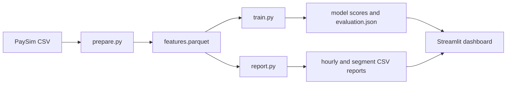

# Project guide: understand the fraud analytics project

This guide explains what the project does, why each part exists, how the pieces fit together, and how to run it. It is written as a learning companion, so you do not need to know every tool already.

## 1. The project in one sentence

This project uses simulated payment transactions to compare an existing fraud flag with a machine-learning model, then summarizes how much fraud each strategy catches and how many transactions it sends for review.

The aim is to demonstrate an analytics workflow used in fraud strategy work: understand a problem, prepare data, build a model, compare options, visualize results, and explain risk and limitations.

## 2. What question are we trying to answer?

A fraud strategy has trade-offs:

- A strategy that flags more transactions may catch more fraud.
- It may also flag more legitimate transactions, creating extra customer friction and review work.
- A strategy that flags fewer transactions may be easier to operate but miss more fraud.

The project asks: **How do the candidate strategies compare on fraud capture and alert volume in a later time period?** The model score does not automatically block transactions.

## 3. Dataset and its limits

The project uses the public PaySim dataset. It contains synthetic mobile-money transactions produced by a simulator. Download the CSV from the dataset link in the main [README](../README.md), then save it as:

```text
data/raw/paysim.csv
```

The CSV includes transaction time (`step`), type (`type`), amount, account balances, a simulated fraud label (`isFraud`), and an existing simulator rule flag (`isFlaggedFraud`).

This is not real bank or customer data. The transactions, fraud labels, and results are not evidence about any financial institution's actual fraud rates or model performance. The simulator cannot answer whether a particular strategy would work against real first-party or third-party fraud.

## 4. How the workflow fits together



- **Prepare:** read the CSV, derive historical account activity, exclude fields that would reveal information unavailable at decision time, and save a compact Parquet file.
- **Train:** use older observations to train a model and a later time period to evaluate it. Compare several model thresholds with the existing simulator flag.
- **Report:** summarize transaction activity by hour and transaction type.
- **Dashboard:** display trend, segment, and strategy comparison graphs from the generated reports.

## 5. What each important file does

| File | Purpose |
|---|---|
| `README.md` | Short project overview and run instructions |
| `requirements.txt` | Python libraries used by the project |
| `pyproject.toml` | Makes the source package installable with `pip install -e .` |
| `src/fraud_strategy/prepare.py` | Converts the raw CSV into point-in-time feature data using DuckDB |
| `src/fraud_strategy/train.py` | Fits the classifier, evaluates thresholds, and saves scores and metrics |
| `src/fraud_strategy/report.py` | Creates hour and transaction-type monitoring reports |
| `dashboard.py` | Streamlit app that reads reports and draws graphs |
| `sql/fraud_strategy.sql` | Example SQL queries for baseline and segment analysis |
| `config/strategy_assumptions.json` | Records threshold and capacity assumptions |
| `docs/data_dictionary.md` | Explains the dataset columns |
| `docs/feature_timing.md` | Describes leakage and feature-time controls |
| `docs/strategy_design.md` | Describes the decision and strategy trade-offs |
| `docs/risk_governance.md` | Describes project risks, controls, and limitations |
| `docs/job_alignment.md` | Maps project work to fraud analytics responsibilities |

Generated files go into `data/processed/` and `reports/`. Those outputs and the downloaded raw CSV are not committed to Git.

## 6. How the data is prepared

The preparation step reads PaySim using DuckDB. DuckDB can query large CSV and Parquet files without requiring the entire raw file to be manually loaded into a spreadsheet.

The feature output keeps useful pre-transaction values such as amount and the old balances. It also calculates how many earlier transactions and how much earlier transaction value came from the origin account in the previous 24 simulator hours. The current transaction is excluded from that history calculation.

Some columns are intentionally not model predictors:

- `isFraud` is the answer the model learns to predict. Including it as an input would let the model see the answer.
- `isFlaggedFraud` is reserved for comparing the existing rule with the model.
- `newbalanceOrg` and `newbalanceDest` describe balances after a transaction, so they may not be available at decision time.
- Raw account identifiers are used only to calculate history and are not saved as model features.

This is called **leakage control**: preventing the model from learning from information that would not have been available when a real decision was made. See [feature timing](feature_timing.md).

## 7. What the model does

The model is logistic regression, a common classification method that estimates a probability for each transaction. It receives transaction amount, pre-transaction balances, prior origin-account activity, and transaction type.

The model uses a chronological split: earlier data is used for training, and later data is held back for evaluation. This is more realistic than randomly mixing past and future transactions when the goal is to reason about future fraud.

A probability is not automatically a decision. A **threshold** is a chosen cutoff: if the score is at or above that value, the row is counted as an alert candidate. The project compares several thresholds to make the trade-off visible. A lower threshold generally creates more alerts; whether that is acceptable depends on expected fraud capture and the team's review capacity.

## 8. How to understand the evaluation metrics

- **Alert count / alert rate:** how many test transactions the strategy would send for review, and what fraction of the test set that represents.
- **Precision:** among alert candidates, the fraction labeled as simulated fraud. Higher precision means fewer false alerts per true alert.
- **Recall:** among all simulated fraud cases in the test set, the fraction that the strategy flagged. Higher recall means less simulated fraud was missed.
- **Fraud amount captured:** the transaction amount associated with flagged rows that were labeled fraud. It is a useful exposure summary, not guaranteed recoveries or savings.
- **Legitimate alerts:** flagged rows whose simulated label says they are not fraud. This is a proxy for added review or customer friction, not a measured customer outcome.
- **ROC AUC:** how well the model ranks fraud rows above non-fraud rows across many possible thresholds. It does not pick a threshold or prove that the model is useful at an operational alert volume.
- **Average precision:** a summary of precision/recall performance that is useful when fraud is rare. It should be interpreted alongside the fraud prevalence in the test period.

The existing simulator flag is a baseline, not a ground-truth ideal strategy. A model should be assessed at realistic capacity and with customer, operations, and risk constraints before any deployment decision.

## 9. How to read the dashboard graphs

- **Hourly activity and simulated fraud:** shows how transaction and fraud counts change by simulator hour. Look for spikes and changes over time; do not assume a simulator pattern is a real-world threat.
- **Fraud by transaction type:** compares fraud counts and fraud amounts across transaction types. Types are proxies for product/channel segments.
- **Fraud capture versus alert rate:** each point represents one candidate threshold or the existing flag. Higher recall means more fraud cases caught; a higher alert rate means more work and potentially more friction.
- **Fraud dollars captured:** compares the amount associated with flagged simulated-fraud transactions for each strategy.
- **Precision and recall:** shows how alert quality and fraud capture change across strategies.

A good strategy is not simply the one with the highest recall. Compare the alert rate, false alerts, capacity assumption, and risk appetite together.

## 10. Running the project

1. Clone or download this repository.
2. Download PaySim's CSV and place it at `data/raw/paysim.csv`.
3. Open a terminal in the repository root.
4. Create a virtual environment and install dependencies:

   ```bash
   python -m venv .venv
   # Windows PowerShell:
   .venv\Scripts\Activate.ps1
   # macOS/Linux:
   source .venv/bin/activate
   pip install -r requirements.txt
   pip install -e .
   ```

5. Prepare features:

   ```bash
   python -m fraud_strategy.prepare --input data/raw/paysim.csv --output data/processed/features.parquet
   ```

6. Train and evaluate:

   ```bash
   python -m fraud_strategy.train --input data/processed/features.parquet --output reports
   ```

7. Generate monitoring summaries:

   ```bash
   python -m fraud_strategy.report --input data/processed/features.parquet --output reports
   ```

8. Open the dashboard:

   ```bash
   streamlit run dashboard.py
   ```

The dashboard opens in a browser. If it says reports are missing, complete steps 5–7 first.

## 11. How this project was created

The project was designed by translating common fraud analytics responsibilities into a reproducible portfolio workflow:

1. **Choose a fraud problem:** compare a baseline rule with a candidate model.
2. **Choose a public dataset:** use synthetic transaction data so no private or customer records are needed.
3. **Define the decision trade-off:** fraud caught versus alert volume and likely operational burden.
4. **Build data preparation:** use SQL/DuckDB for repeatable transformations and time-aware history.
5. **Build the model comparison:** use Python and scikit-learn, with a chronological holdout.
6. **Create useful outputs:** save metrics and monitoring tables so results can be reviewed and visualized.
7. **Document responsible use:** explain leakage controls, assumptions, and what synthetic results cannot prove.

This is a demonstration of analysis and communication skills. It does not claim work experience or production deployment.

## 12. Next improvements

- Add precision-recall and alert-volume curves by transaction type.
- Add a configurable maximum alerts-per-hour capacity and show which threshold meets it.
- Compare results over multiple chronological windows rather than a single holdout.
- Add confidence intervals or resampling to communicate uncertainty.
- Add drift indicators for transaction mix, amount, and model scores.
- Replace synthetic data with approved, privacy-reviewed data only if working in an authorized environment.

For governance and limitations, read [risk governance](risk_governance.md).